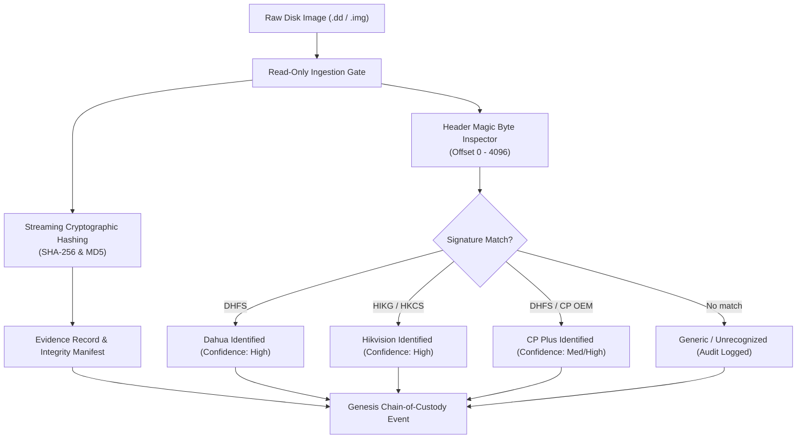

# Mini-Project Phase 1 Implementation Plan (Week 1)
**Project Title:** Development of a Multi-Vendor DVR/NVR Forensic Analysis Tool for Standardized Acquisition, Recovery, and Analysis of Surveillance Evidence  
**Domain:** Cybersecurity & Digital Forensics  
**Problem Statement ID:** SIH26150  
**Phase Duration:** Week 1 (7 Days)  
**Phase Name:** Evidence Acquisition, Cryptographic Integrity Hashing & Automated Vendor Signature Detection  

---

## 1. Executive Summary & Objective

In digital surveillance forensics, raw disk images from CCTV DVRs/NVRs cannot be mounted using traditional operating system drivers due to proprietary file systems and non-standard partition layouts. Before any carving or video parsing can begin, forensic standards (ISO/IEC 27037) mandate strict acquisition integrity and accurate vendor identification.

The goal of **Phase 1 (Week 1)** is to deliver an end-to-end, validated foundation that:
1. Ingests raw storage media images (`.dd`, `.img`, `.raw`, `.bin`) strictly in **read-only** mode.
2. Computes dual cryptographic hashes (**SHA-256** and **MD5**) over chunked streams with zero memory exhaustion.
3. Automatically identifies the DVR/NVR manufacturer (Dahua, Hikvision, CP Plus, or Generic/Unrecognized) via low-level header signature inspection.
4. Initializes a tamper-evident **Chain of Custody (CoC)** record in SQLite.
5. Verifies all behaviors through automated unit tests with synthetic forensic fixtures.



---

## 2. Phase 1 Scope Boundary (Week 1 Only)

To maintain focus and ensure a verifiable submission for Week 1 faculty review, boundaries are defined below:

### In Scope for Week 1
- **Read-Only File Handler:** Enforce read-only locks on source disk images.
- **Dual Stream Hashing:** Incremental 64 KB chunk hashing for SHA-256 and MD5.
- **Vendor Signature Identification:**
  - Dahua (`DHFS` signature at sector 0 or standard offsets).
  - Hikvision (`HIKG`, `HKCS`, or `HIKVISION` partition headers).
  - CP Plus (Dahua OEM variant / custom CP headers).
  - Fallback: Deterministic `UNKNOWN / GENERIC` result without fabricated detections.
- **Genesis Chain of Custody Record:** Auto-generate evidence ingestion timestamp, acquisition hash, case identifier, and operator note.
- **Automated Test Suite:** Pytest tests verifying detection accuracy, hash consistency, and tamper prevention.

### Strictly Out of Scope (Deferred to Future Weeks)
- *Phase 2 (Week 2):* Proprietary Index Table and File System Parsing.
- *Phase 3 (Week 3):* Raw Video Carving (H.264/H.265 NAL byte boundary carving).
- *Phase 4 (Week 4):* Multi-Channel Timeline Normalization and Clock Drift Correction.
- *Phase 5 (Week 5):* AI Motion/Object Detection Analytics.
- *Phase 6 (Week 6):* Final Court-Admissible PDF Report Generation & UI Polish.

---

## 3. Day-by-Day Work Breakdown (Week 1 Schedule)

| Day | Milestone | Technical Tasks | Deliverables |
| :--- | :--- | :--- | :--- |
| **Day 1** | **Forensic Ingestion & Safety** | • Implement strict read-only file wrapper (`rb` mode).<br>• Add OS-level permission validation to prevent accidental write handles.<br>• Validate image header accessibility and size detection. | `packages/forensics/io/readonly.py`<br>Test: `test_readonly_access.py` |
| **Day 2** | **Dual Cryptographic Hashing** | • Implement chunked streaming hash service (MD5 + SHA-256).<br>• Support large images (>10 GB) with constant memory footprint.<br>• Provide real-time byte progress callback mechanism. | `packages/forensics/hashing/hasher.py`<br>Test: `test_dual_hash_integrity.py` |
| **Day 3** | **Signature Matrix & Detection Engine** | • Define signature rules for Dahua (`DHFS`), Hikvision (`HIKG`, `HKCS`), CP Plus.<br>• Implement multi-offset header scanner (Sectors 0, 1, and 64).<br>• Build confidence scoring (High, Medium, Unknown). | `packages/adapters/signatures.py`<br>`packages/adapters/detector.py` |
| **Day 4** | **Adapter Integration & Factory** | • Hook detector into `AdapterRegistry`.<br>• Return vendor metadata: Vendor Name, Family, Detected Magic, Detected Offset, Confidence.<br>• Implement graceful unknown fallback. | Updated `packages/adapters/registry.py`<br>Updated `packages/adapters/base.py` |
| **Day 5** | **Database & Genesis Custody Log** | • Wire ingestion into SQLite repository.<br>• Create `Evidence` record with initial hashes and vendor tag.<br>• Generate first `ChainOfCustody` log entry (`ACTION = ACQUIRED`). | `apps/api/app/services/evidence_service.py`<br>SQLite Migration / Schema update |
| **Day 6** | **Synthetic Fixtures & Unit Tests** | • Create minimal synthetic disk image headers for Dahua and Hikvision.<br>• Write end-to-end tests: valid Dahua, valid Hikvision, corrupted header, unknown disk.<br>• Verify hash matches ground truth. | `fixtures/signatures/`<br>`tests/unit/test_vendor_detection.py` |
| **Day 7** | **Documentation & Guide Viva Prep** | • Compile Phase 1 progress report for faculty review.<br>• Verify code passes all pytest test suites.<br>• Prepare viva demonstration scripts and screenshots. | `docs/PHASE_1_REPORT.md`<br>100% Passing Test Log |

---

## 4. Technical Architecture & Data Contracts

### 4.1 Signature Identification Specification
```python
VENDOR_SIGNATURES = {
    "DAHUA": [
        {"magic": b"DHFS", "offset": 0, "family": "Dahua DHFS4.1"},
        {"magic": b"DHFS", "offset": 512, "family": "Dahua DHFS Sector 1"},
    ],
    "HIKVISION": [
        {"magic": b"HIKG", "offset": 0, "family": "Hikvision Master Sector"},
        {"magic": b"HKCS", "offset": 0, "family": "Hikvision File System"},
        {"magic": b"HIKVISION", "offset": 0, "family": "Hikvision Extended Header"},
    ],
    "CP_PLUS": [
        {"magic": b"DHFS", "offset": 0, "family": "CP Plus (Dahua OEM)"},
    ]
}
```

### 4.2 Ingestion & Detection Contract (Pydantic Schema)
```python
class AcquisitionMetadata(BaseModel):
    evidence_id: str
    file_path: str
    file_size_bytes: int
    md5_hash: str
    sha256_hash: str
    acquisition_timestamp: datetime  # UTC ISO-8601
    
class VendorDetectionResult(BaseModel):
    vendor: str                      # DAHUA | HIKVISION | CP_PLUS | UNKNOWN
    detected_family: str             # e.g., "Dahua DHFS4.1"
    matched_signature: str | None    # e.g., "44484653" (hex for DHFS)
    signature_offset: int | None     # byte offset where matched
    confidence: str                  # HIGH | MEDIUM | LOW | UNRECOGNIZED
    is_supported: bool
```

---

## 5. Faculty / Project Guide Review Checklist

When presenting Phase 1 at the end of Week 1, present the following artifacts:

- [ ] **Working Demo:** Run CLI command or API endpoint that takes a raw `.img` file and outputs:
  - Computed MD5 and SHA-256 hashes.
  - Detected vendor name and confidence score.
  - Evidence row inserted into SQLite with `ACQUIRED` custody status.
- [ ] **Forensic Integrity Proof:** Demonstrate that the source image was opened strictly in read-only mode and its SHA-256 hash remains unchanged before and after detection.
- [ ] **Automated Test Report:** Clean pytest run output showing all unit tests passing.
- [ ] **Code Quality:** Type hints, modular package separation under `packages/adapters` and `packages/forensics`.

---

## 6. Viva Defense Questions & Answers for Week 1

**Q1: Why do you compute both MD5 and SHA-256 instead of just one?**  
*Answer:* MD5 is computationally fast and historically standard in digital forensics, but MD5 collisions are theoretically possible. SHA-256 provides modern cryptographic collision resistance required by court admissibility standards. Dual-hashing satisfies both legacy compliance and cryptographic rigor.

**Q2: How do you guarantee the forensic disk image is not altered during inspection?**  
*Answer:* The engine opens files exclusively using the binary read-only flag (`rb`). Furthermore, an initial verification hash is recorded immediately upon ingestion. Before any processing, the hash is re-computed to mathematically prove zero byte divergence.

**Q3: How does your tool detect the DVR vendor if there is no standard MBR or GPT partition?**  
*Answer:* Proprietary DVRs write directly to disk sectors without standard NTFS/EXT partitions. We inspect known magic byte offsets (such as `DHFS` for Dahua at offset 0/512 or `HIKG`/`HKCS` for Hikvision) against our vendor signature matrix. If no known signature matches, we classify it as `UNKNOWN` rather than fabricating a false match.
